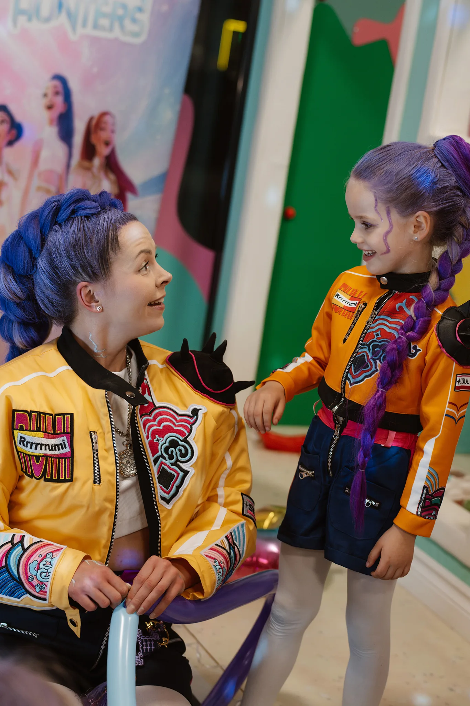
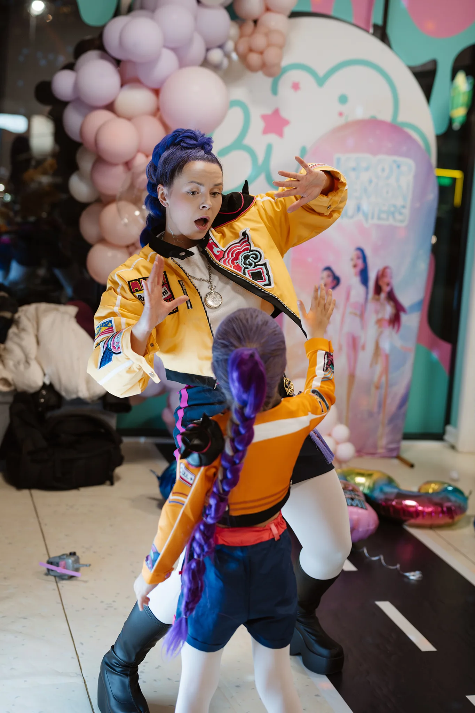

<a href="#uzklausa" class="btn-large waves-effect waves-light dp-btn section-header" data-quick-inquiry-open>Patikrinti datą ir gauti pasiūlymą</a>

<section class="birthday-offers" aria-labelledby="birthday-offers-title">
  <h2 class="section-header" id="birthday-offers-title">Gimtadienio programos ir kainos</h2>
  
Gimtadienio animacija Vilniuje - nuo 100 €. Galutinę kainą pateikiame pagal pasirinktą programą, vietą, datą ir trukmę. Į pasiūlymą įeina nurodyto personažo programa ir jos veikloms reikalingas rekvizitas. Šventės vietos nuoma, maistas ir tortas neįskaičiuoti.

  <table class="offer-comparison">
    <caption class="kg-font kg-font--small">Palyginkite veiklas, trukmę ir personažų skaičių</caption>
    <thead><tr><th scope="col">Programa</th><th scope="col">Kaina Vilniuje</th><th scope="col">Trukmė ir komanda</th><th scope="col">Kas įeina</th></tr></thead>
    <tbody>
      <tr>
        <th scope="row">Klasikinė: žaidimai, tatuiruotės ir balionai</th>
        <td data-label="Kaina Vilniuje">Nuo 100 €</td>
        <td data-label="Trukmė ir komanda">1 val. 1 animatorius su pasirinktu personažu</td>
        <td data-label="Kas įeina">Judrūs žaidimai, šokiai, laikinos tatuiruotės ir balionėlių lankstymas. Veiklas pritaikome pagal personažą ir vaikų amžių. <a class="btn-large waves-effect waves-light dp-btn section-header dp-action-button" href="#uzklausa" data-quick-inquiry-open data-inquiry-program="Klasikinė programa: tatuiruotės ir balionai" data-inquiry-service="birthday-classic-balloons">Pasirinkti šį variantą</a></td>
      </tr>
      <tr>
        <th scope="row">Klasikinė: žaidimai ir veidukų piešimas</th>
        <td data-label="Kaina Vilniuje">Nuo 100 €</td>
        <td data-label="Trukmė ir komanda">1 val. 1 animatorius su tinkamu personažu</td>
        <td data-label="Kas įeina">Žaidimai, šokiai ir veidukų piešimas. Tai alternatyva tatuiruočių ir balionų variantui. Žmogus Voras veidukų nepiešia. <a class="btn-large waves-effect waves-light dp-btn section-header dp-action-button" href="#uzklausa" data-quick-inquiry-open data-inquiry-program="Klasikinė programa: veidukų piešimas" data-inquiry-service="birthday-classic-facepaint">Pasirinkti šį variantą</a></td>
      </tr>
      <tr>
        <th scope="row">Rumi Basic</th>
        <td data-label="Kaina Vilniuje">Individualus pasiūlymas</td>
        <td data-label="Trukmė ir komanda">1 val. 1 Rumi personažas</td>
        <td data-label="Kas įeina">Įšventinimas į Demon Hunters komandą, Huntrix tatuiruotės, žaidimai ir šokiai. <a class="btn-large waves-effect waves-light dp-btn section-header dp-action-button" href="#uzklausa" data-quick-inquiry-open data-inquiry-program="Rumi Basic" data-inquiry-service="birthday-rumi-basic">Pasirinkti Rumi Basic</a></td>
      </tr>
      <tr>
        <th scope="row">Rumi Premium</th>
        <td data-label="Kaina Vilniuje">Individualus pasiūlymas</td>
        <td data-label="Trukmė ir komanda">1 val. 1 gyvai dainuojanti Rumi atlikėja</td>
        <td data-label="Kas įeina">Visa Basic programa ir gyvas dainavimas. Prieš patvirtindami užsakymą patikriname dainuojančios atlikėjos užimtumą. <a class="btn-large waves-effect waves-light dp-btn section-header dp-action-button" href="#uzklausa" data-quick-inquiry-open data-inquiry-program="Rumi Premium" data-inquiry-service="birthday-rumi-premium">Pasirinkti Rumi Premium</a></td>
      </tr>
      <tr>
        <th scope="row">Rumi Premium Plus</th>
        <td data-label="Kaina Vilniuje">Individualus pasiūlymas</td>
        <td data-label="Trukmė ir komanda">1 val. 1 Rumi personažas</td>
        <td data-label="Kas įeina">Visa Premium programa, jubiliatės Rumi šukuosena ir talismanas. Šiuos priedus ir atlikėjos užimtumą patvirtiname pasiūlyme. <a class="btn-large waves-effect waves-light dp-btn section-header dp-action-button" href="#uzklausa" data-quick-inquiry-open data-inquiry-program="Rumi Premium Plus" data-inquiry-service="birthday-rumi-plus">Pasirinkti Rumi Premium Plus</a></td>
      </tr>
    </tbody>
  </table>
</section>

<section class="birthday-conditions kg-font kg-font--small" aria-labelledby="birthday-conditions-title">
  <h2 class="section-header" id="birthday-conditions-title">Kokią programą rinktis Jūsų šventei?</h2>
  
<strong>Vieta.</strong> Dirbame Vilniuje ir Kaune, atvykstame ir į kitus Lietuvos miestus. Programos kainą ir kelionę nurodome konkrečiame pasiūlyme pagal Jūsų šventės vietą.

  
<strong>Vaikų skaičius ir trukmė.</strong> Vienas animatorius orientuojasi į grupę iki 15 vaikų. Didesnei grupei pasiūlysime tinkamą komandos dydį. Jei dalyvaus daugiau nei 10 vaikų arba norėsite daugiau laiko individualioms veikloms, aptarsime 1,5 val. programą ir jos kainą.

  
<strong>Gruodžio šventės.</strong> Gruodžio šventėms pasiūlymą sudarome individualiai pagal datą, vietą ir programą. Tikslią programos sudėtį, trukmę ir visą mokėtiną sumą patvirtiname prieš rezervaciją.

  
Ieškote kitokio formato? Peržiūrėkite kitas švenčių programas. Eksperimentams atskirai įvertiname erdvę ir tinkamas veiklas.

<a class="btn-large waves-effect waves-light dp-btn section-header dp-action-button" href="/programos/rumi-demon-hunters/">Rumi Demon Hunters programa</a><a class="btn-large waves-effect waves-light dp-btn section-header dp-action-button" href="/programos/">Visos švenčių programos</a>

</section>

<section class="birthday-example row" aria-labelledby="birthday-example-title">
  
<figure>

<figcaption>Akimirkos iš mūsų Rumi gimtadienio galerijos.</figcaption></figure>

  
<h2 class="section-header" id="birthday-example-title">Rumi gimtadienio akimirka</h2>
Šioje šventėje Rumi susitiko su mažąja savo heroje - abi pasipuošusios derančiais kostiumais ir violetinėmis kasomis. Nuotraukose - jų bendravimas ir bendri judesiai žaidimų erdvėje.

Jei Jūsų vaikas laukia Rumi, galite pasirinkti Basic, Premium arba Premium Plus programą. Nuotraukoje matomas vaiko kostiumas nėra programos kainos dalis.

Dar neišsirinkote herojaus? Peržiūrėkite personažus arba užklausoje palikite bendrą gimtadienio programą - padėsime pasirinkti.

<a class="btn-large waves-effect waves-light dp-btn section-header dp-action-button" href="/programos/rumi-demon-hunters/">Rumi programa ir nuotraukos</a><a class="btn-large waves-effect waves-light dp-btn section-header dp-action-button" href="/personazai/">Visi personažai</a>

</section>


